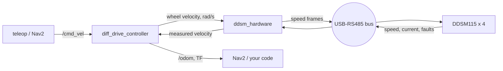

<h1 align="center">DDSM115 ROS 2</h1>

<p align="center">
  Set up, test and drive <b>Waveshare DDSM115</b> hub motors over RS485, with or without ROS 2.<br>
  Assign motor IDs, spin-test the wheels, then drive a 2- or 4-wheel robot with <code>ros2_control</code>.
</p>

<p align="center">
  <a href="https://github.com/b-dosymzhan/ddsm115_ros2/actions/workflows/ci.yml"></a>
  
  
  
  <a href="LICENSE"></a>
</p>

## Why this repository

Waveshare documents the raw RS485 frames of the DDSM115, but there is no ROS 2 driver and no tool
to set up a set of motors. Getting a robot to drive meant solving the same problems again: motor
IDs, mirrored wheels, replies that arrive in pieces, stale bytes on the bus. This repository
packages everything that made our 4-wheel robot work:

| | |
|---|---|
| 🔧 [`tools/ddsm.py`](tools/ddsm.py) | One-file command line tool for Linux, macOS and Windows. **Assign motor IDs**, find the motors on the bus, spin them with live feedback, send raw frames. Needs only `pyserial`. |
| 🤖 [`ddsm_hardware`](ddsm_hardware) | **ros2_control hardware interface** (ROS 2 Humble). Any number of motors on one bus, velocity commands, velocity and position states, zero speed on shutdown. |
| 🚗 [`ddsm_example`](ddsm_example) | A 2- or 4-wheel robot (differential drive or skid-steer). One launch command, then drive it with the keyboard. |
| 📖 [`docs/`](docs) | The [protocol](docs/protocol.md) with checked example frames, [wiring and mounting](docs/wiring.md), [calibration](docs/ros2_control.md) and the [problems we hit](docs/troubleshooting.md). |

## Hardware

| [DDSM115 hub motor](https://www.waveshare.com/wiki/DDSM115) | [DDSM Driver HAT (A)](https://www.waveshare.com/wiki/DDSM_Driver_HAT_(A)) (optional, power only) | USB-RS485 adapter |
|:---:|:---:|:---:|
|  |  | any adapter with automatic direction control, for example CH340 based |

<sub>Product images: © Waveshare, from the linked wiki pages.</sub>

- DDSM115 motors and a 12–24 V supply. We used a 4S Li-Po battery (14.8 V, 9000 mAh).
  Different DDSM models cannot share one bus.
- A USB-RS485 adapter.
- Python 3 with `pyserial` for the tool, ROS 2 Humble for the driver.

**How we connected it.** The computer talks to the motors **directly over the RS485 bus**
through the USB-RS485 adapter. We used the Waveshare DDSM Driver HAT (A) **only for power**,
because sending commands through its ESP32 did not work for us. Through the HAT's USB port the
ESP32 expects Waveshare's JSON commands, not the raw frames used here.

<p align="center">
  
</p>

More in [docs/wiring.md](docs/wiring.md): power, emergency stop, serial ports and how we mounted
the motors.

## 1. Give every motor its own ID

All motors share one bus, so each needs a unique ID. **Connect one motor at a time:**

```bash
pip install pyserial          # or: sudo apt install python3-serial
python3 tools/ddsm.py --port /dev/ttyUSB0 get-id     # which ID does it have now?
python3 tools/ddsm.py --port /dev/ttyUSB0 set-id 1   # give it ID 1
```

- The motor takes a new ID only after receiving the set-ID frame 5 times. The tool sends it 5 times.
- An ID can be set **once per power-up**. To change it again, power-cycle the motor.
- The ID is kept when the power is off. Write it on the motor.
- With several motors connected, all of them would take the same ID.

Then connect all motors and check that every ID answers:

```bash
python3 tools/ddsm.py --port /dev/ttyUSB0 scan --range 1-10
```

On Windows use `python tools\ddsm.py --port COM5 ...`. On Linux, `ls -l /dev/serial/by-id/` shows
the adapter.

## 2. Spin test

Lift the wheels off the ground, then:

```bash
python3 tools/ddsm.py --port /dev/ttyUSB0 spin --ids 1 2 3 4 --rpm 60 --directions 1 1 -1 -1
```

```
target 60 rpm | w forward, s reverse, q or space stop, Esc exit

motor   1 | cmd   60 rpm | speed   58 rpm | angle   73.8 deg | current  0.10 A | temp  27 C | OK
motor   2 | cmd   60 rpm | speed   61 rpm | angle  264.6 deg | current  0.09 A | temp  27 C | OK
motor   3 | cmd  -60 rpm | speed  -59 rpm | angle   35.2 deg | current -0.10 A | temp  26 C | OK
motor   4 | cmd  -60 rpm | speed  -60 rpm | angle  317.8 deg | current -0.10 A | temp  28 C | OK
```

`w` forward, `s` reverse, `q` stop, `Esc` exit. Fault flags (stall, overcurrent, …) show up in the
last column. The motors are always stopped on exit.

Motors on the left and right of a robot are mirrored, so one side turns backward. Find the
`--directions` that drive every wheel forward. These are the `motor_directions` for ROS.

## 3. Drive it with ROS 2

```bash
mkdir -p ~/ddsm_ws/src && cd ~/ddsm_ws/src
git clone https://github.com/b-dosymzhan/ddsm115_ros2.git
cd ~/ddsm_ws
rosdep install --from-paths src --ignore-src -y
colcon build && source install/setup.bash

ros2 launch ddsm_example bringup.launch.py port:=/dev/ttyUSB0 wheels:=4 \
    motor_ids:=1,2,3,4 motor_directions:=1,1,-1,-1
ros2 run teleop_twist_keyboard teleop_twist_keyboard       # in a second terminal
```



| Topic | |
|---|---|
| `/cmd_vel` (`geometry_msgs/Twist`) | velocity command |
| `/odom`, TF `odom → base_link` | wheel odometry |
| `/joint_states` | wheel positions and velocities |

The motor lists follow the joint order: `front_left, rear_left, front_right, rear_right`
(4 wheels) or `left, right` (2 wheels).

### In your own robot

Add this to your URDF and list your wheel joints in the same order as the motor lists:

```xml
<ros2_control name="DDSM115" type="system">
  <hardware>
    <plugin>ddsm_hardware/DDSMHardwareInterface</plugin>
    <param name="port">/dev/ttyUSB0</param>
    <param name="motor_ids">1,2,3,4</param>
    <param name="motor_directions">1,1,-1,-1</param>
    <param name="motor_trims">1.0,1.0,1.0,1.0</param>   <!-- optional -->
    <param name="rpm_limit">330</param>                  <!-- optional -->
  </hardware>
  <joint name="front_left_wheel_joint">
    <command_interface name="velocity"/>
    <state_interface name="velocity"/>
    <state_interface name="position"/>
  </joint>
  <!-- ... one block per wheel -->
</ros2_control>
```

[docs/ros2_control.md](docs/ros2_control.md) lists every parameter. It also explains how to
calibrate the directions, straight-line trims and the effective wheel separation of a skid-steer
robot.

## The protocol in 30 seconds

115200 baud, 8N1. Every frame has 10 bytes and the last byte is a CRC-8/MAXIM of the first 9.

| Frame | Bytes | Reply |
|---|---|---|
| Speed | `ID 64 rpm_hi rpm_lo 00 00 accel brake 00 CRC` | speed, current, 16-bit position, faults |
| Feedback | `ID 74 00 00 00 00 00 00 00 CRC` | speed, current, temperature, 8-bit position, faults |
| Mode | `ID A0 00 00 00 00 00 00 00 mode` (no CRC) | none |
| Set ID | `AA 55 53 ID 00 00 00 00 00 CRC`, 5 times | none |
| Get ID | `C8 64 00 00 00 00 00 00 00 DE` | like the speed reply |

`ddsm.py frame speed 1 100` prints any frame with its CRC (`01 64 00 64 00 00 00 00 00 4F`), for use
from an Arduino, ESP32 or PLC. All the details are in [docs/protocol.md](docs/protocol.md).

## DDSM115 at a glance

| | |
|---|---|
| Supply | 12–24 V |
| Speed | rated 115 rpm, no load 200 ± 10 rpm, about 11 rpm per volt |
| Torque | rated 0.96 N·m, stall 2.0 N·m |
| Current | rated 1.25 A, stall ≤ 2.7 A |
| Encoder | 4096 counts per revolution |
| Tyre | 100.7 mm diameter, 43 mm wide |
| Weight | 765 g |
| Bus | RS485, 115200 baud, IDs 1–253 |

<sub>Datasheet values from Waveshare.</sub>

## Development

```bash
python3 -m pytest tools                    # the tool, against a simulated motor bus
colcon test && colcon test-result --all    # protocol gtests, URDF test, ament linters
```

CI builds and tests the ROS 2 packages on Humble, and the tool on Linux, Windows and macOS.

## License

[Apache-2.0](LICENSE)

If this saved you time, a ⭐ helps other DDSM115 users find it.
