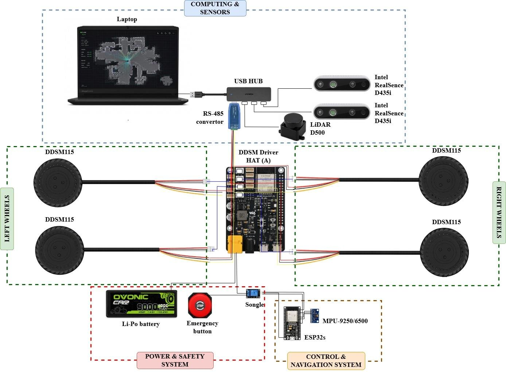
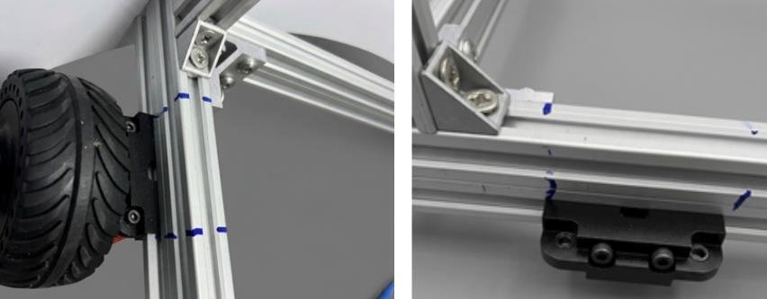

# Wiring and mounting



This is how our robot is wired:

- A laptop is connected to a USB hub.
- The hub connects the USB-RS485 adapter and the sensors.
- The adapter talks to the four DDSM115 motors.
- The DDSM Driver HAT (A) distributes the battery power to the motors.
- The emergency button and a relay controlled by an ESP32 can cut the motor power.

```
                 USB                 RS485 A/B + GND
  Computer ─────────────── USB-RS485 ─────────────────┬──────────┬──────────┬──────────┐
                           adapter                    │          │          │          │
                                                   motor 1    motor 2    motor 3    motor 4
                                                      │          │          │          │
  Battery 12–24 V ── fuse ── e-stop / relay ──────────┴──────────┴──────────┴──────────┘
                                                      motor power (V+ / GND)
```

## Motors

- Each DDSM115 cable carries the motor power and the RS485 pair. Follow the pinout in the
  [Waveshare wiki](https://www.waveshare.com/wiki/DDSM115) for your cable.
- All motors share one RS485 bus: every A to A, every B to B. Each motor needs its own ID
  (see [the README](../README.md#1-give-every-motor-its-own-id)).
- Supply 12–24 V. The motors need their own power: the USB adapter only carries the signal.
  We used a 4S Li-Po battery (14.8 V, 9000 mAh) on an XT60 connector.
- Connect the GND of the adapter to the GND of the motor supply, so the RS485 signal has a common
  reference.
- Different DDSM models (DDSM115, DDSM210, …) use different frames and cannot share one bus.
- Do not run a motor lying loose on a table: the hub spins the whole tyre. Fix the axle, or lift
  the robot so the wheels turn freely.

## USB-RS485 adapter

Use an adapter that switches the transmit direction **automatically**. Ours is a CH340 adapter with
A, B, GND and +5V terminals, and most similar adapters work too. Adapters without automatic
direction need the software to toggle a pin, which neither the tool nor the driver does.

If no motor answers, swap A and B. Mislabelled adapters are common, and swapping is harmless.

## Waveshare DDSM Driver HAT (A)


<sub>Image: © Waveshare, [DDSM Driver HAT (A) wiki](https://www.waveshare.com/wiki/DDSM_Driver_HAT_(A)).</sub>

The HAT has:
- a 9–28 V input on XT60 (or DC 5525)
- four DDSM115 motor ports and four DDSM210 ports
- an ESP32 with a "serial port control" switch

With the switch on ESP32, the computer controls the motors through the ESP32-USB port with
Waveshare's **JSON commands**, not with the raw RS485 frames this repository uses.

On our robot the HAT is used **only for power**. Sending commands through the HAT's ESP32 did not
work for us, and we got no usable feedback through it either. So the computer talks to the motors
directly: the USB-RS485 adapter is wired to the motors' RS485 lines (A, B, GND) on the HAT. It
sends the raw frames, and the motors' replies come back the same way. Everything in this
repository works this way. You can also skip the HAT and wire the power yourself.

## Emergency stop

Cut the **motor power**, not the signal: a stop sent over the bus needs a working computer, cable
and bus. On our robot:
- A **normally-closed emergency button** is in series with the motor power, so pressing it cuts
  the power without any software.
- A **5 V relay** (SRD-05VDC-SL-C) is also in series. An ESP32 drives it from a ROS topic. The
  relay's normally-open contact is used, so the motors lose power whenever the control signal is
  lost.

## Mounting the motors



We mounted each DDSM115 on a Waveshare **UGV DDSM Suspension (A)**, the 7.5 kg version, bolted to
a 20 mm aluminium profile frame. The suspension takes the DDSM115 shaft directly:
- shaft Ø 19 mm × 15 mm, with the cable running through it
- mounting hole Ø 11.6 mm
- total width with the shaft 50.5 mm

No adapter bracket is needed. Mark the suspension positions on the frame before you take things
apart. Check that the frame corners are exactly 90°: a twisted frame makes the robot noisy and pull
to one side.

## Serial port on Linux

```bash
ls -l /dev/serial/by-id/                  # find the adapter
sudo usermod -aG dialout $USER            # permission to open it, then log out and back in
```

`/dev/ttyUSB0`, `/dev/ttyUSB1`, … are numbered in plug-in order and can change after a reboot.
Use the stable `/dev/serial/by-id/...` path in launch files, for example
`port:=/dev/serial/by-id/usb-1a86_USB_Serial-if00-port0`.

## Serial port on Windows

The adapter shows up as `COMx` in Device Manager. CH340 adapters may need the CH340 driver.
Then `python tools\ddsm.py --port COM5 scan`.
